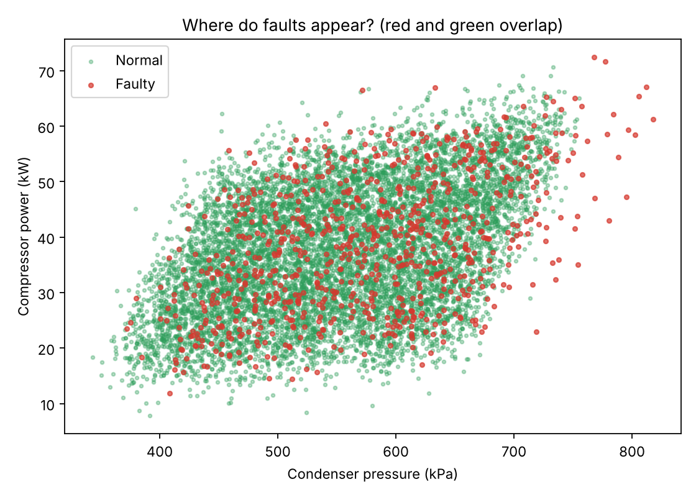
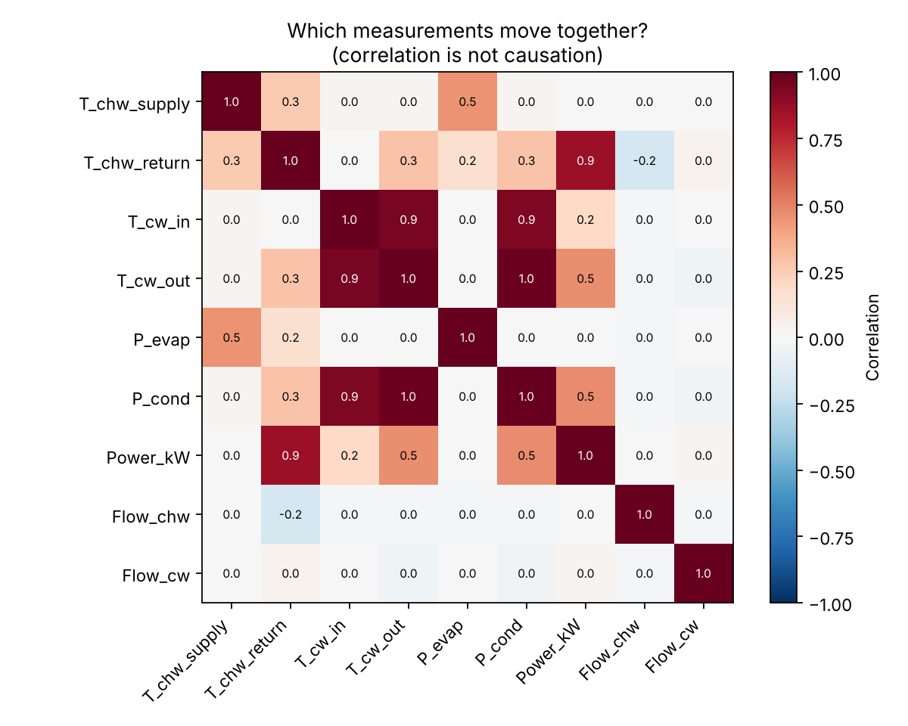
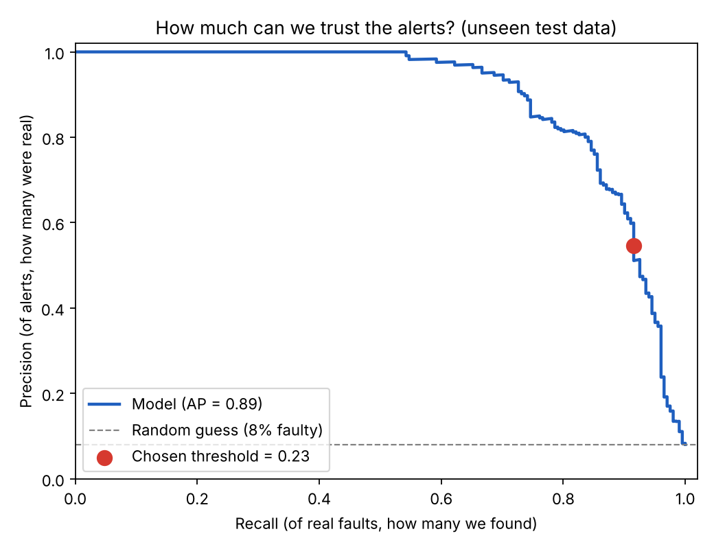

# Chiller Fault Detection with Machine Learning

A beginner-friendly practice project: detecting chiller faults (condenser fouling, refrigerant leak, low evaporator flow, low condenser flow) from **simulated** sensor data (temperatures, pressures, water flow, compressor power) using a Random Forest classifier.

> **Note:** The data is simulated with deliberately simplified physics and is not calibrated to a real chiller. The results show how the concepts work, not performance on a real chiller.

## What it covers
- Binary classification: normal vs. faulty (about 8% faulty, i.e. class imbalance)
- Why fault-type columns are excluded from the model (data leakage)
- Train/test split on unseen data
- Recall vs. Precision instead of accuracy
- Choosing the alert threshold based on cost (a missed fault costs 10x a false alarm)

## Results (on 2,500 unseen test records)
- Alert threshold: 0.23
- Recall: 91.5% (184 of 201 real faults were found)
- Precision: 54.6% (184 of 337 alerts were real faults)

The more we try to miss no fault, the more false alarms we get. This trade-off is controlled by the alert threshold and has to be set based on cost.

## Figures

**1. Where do faults appear?** Red (faulty) and green (normal) overlap, so two variables alone are not enough.



**2. Which measurements move together?** The correlation map shows relationships, not causes.



**3. How much can we trust the alerts?** The red dot marks the chosen threshold.



## How to run
```
pip install pandas numpy scikit-learn matplotlib
python chiller_fault_detection.py
```
The script prints the metrics and saves the three figures in the folder you run it from. Try changing `COST_MISSED_FAULT` or `fault_rate` to see how the threshold and Precision change.

## Limitations
- Simulated data: these numbers are not performance on a real chiller.
- The goal is to practice the concepts: class imbalance, Recall vs. Precision, and the alert threshold.

## Next steps
- Repeat with real chiller data (for example, a dataset based on ASHRAE RP-1043)
- Compare other models
